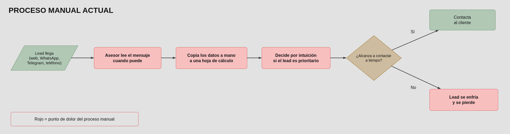
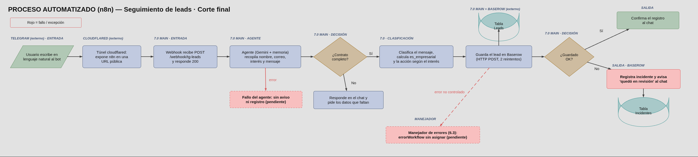

# Seguimiento y clasificación automática de leads

Documento de entrada del repositorio de entrega final del curso **Automatización inteligente de procesos con n8n** (EAM 2026-II, profesor Robert Garcia Rey). Describe qué hace el proyecto, qué se necesita para ponerlo en marcha y cómo importar y ejecutar el workflow.

## 1. Identificación del proyecto

**Proyecto:** Seguimiento y clasificación automática de leads.
**Organización (ficticia):** Inmuebles y Apartamentos Inmonova S.A.S.
**Entregable técnico principal:** `workflows/Workflow_Final.json`, un workflow de n8n de 21 nodos y 23 conexiones con un único disparador.

Inmonova recibe solicitudes de clientes interesados en comprar, arrendar o vender inmuebles por canales distintos, sin un punto único donde se concentren, clasifiquen y prioricen. El asesor lee los mensajes cuando tiene tiempo, copia los datos a mano y decide la prioridad por intuición, de modo que un lead de interés alto puede esperar más de lo conveniente y el equipo no tiene visibilidad del estado de cada solicitud. El proyecto atiende esa necesidad con un flujo que recibe el mensaje del cliente en lenguaje natural, extrae los datos mínimos del lead, clasifica su interés, asigna la acción de seguimiento y deja registro en una base de datos, sin transcripción manual.

El objetivo de la versión final es operar ese recorrido de punta a punta desde Telegram: conversar con el cliente, validar el contrato mínimo de datos, clasificar el correo y el interés con reglas deterministas, guardar el lead en Baserow, confirmar el registro en el chat y registrar como incidente cualquier fallo de guardado. El workflow es autocontenido: no invoca ni depende de otros workflows. La versión no incluye canales distintos de Telegram, notificación al asesor, consulta o modificación de leads existentes, autenticación del webhook, panel de métricas ni deduplicación de leads.

| Elemento | Descripción |
|---|---|
| Integrantes | Johan Hernández, Javier Argoty, Luis Sinisterra, Simón Cruz |
| Canal de entrada | Telegram, mediante webhook |
| Componente de IA | Agente con Google Gemini y memoria de conversación |
| Persistencia | Baserow: tabla de leads (ID `1227763`) y tabla de incidentes (ID `1282332`) |
| Nombre interno del workflow | `Seguimiento leads 7.0 - Main` |

## 2. Vista general

El proceso recorre las siguientes etapas:

1. **Entrada.** El cliente escribe al bot de Telegram de Inmonova en lenguaje natural. Telegram entrega el mensaje como un `POST` a la URL pública del webhook.
2. **Recepción y acuse inmediato.** El nodo `Webhook Telegram` (método `POST`, ruta `tg-leads`) recibe el evento. El nodo `Responder 200 a Telegram` responde de inmediato sin cuerpo (`responseMode: responseNode`), de modo que Telegram no espera el procesamiento y no reintenta el envío.
3. **Conversación y extracción.** `Agente de captación de leads` interpreta el mensaje con Google Gemini y la memoria de la conversación (ventana de 10 mensajes), recopila nombre, correo, interés y mensaje, y devuelve un JSON con `estado` (`recopilando`, `listo` o `sin_registro`), el objeto `lead` y `respuesta_usuario`.
4. **Parseo.** `Parsear mensaje` valida la salida del modelo, normaliza los campos y agrega los metadatos del evento real: `canal`, `chat_id`, `update_id`, `submittedAt` y `formMode`.
5. **Validación del contrato.** `Contrato completo?` exige `estado` igual a `listo`, nombre y mensaje no vacíos, correo con formato válido, interés en `ALTO`/`MEDIO`/`BAJO` y `chat_id` presente. Si falta algo, el flujo responde en el chat pidiendo los datos y no escribe en la base de datos.
6. **Clasificación.** `¿Es correo empresarial?` asigna `es_empresarial`. Después, `Casos Interés` separa los casos ALTO, MEDIO y BAJO y cada rama asigna el campo `accion`.
7. **Unificación y guardado.** `Merge` reúne las tres ramas y `HTTP · Guardar fila Baserow1` crea la fila del lead con `POST` a la API de Baserow, con dos reintentos y salida de error habilitada.
8. **Resultado.** Si el guardado es correcto, `Confirmar registro al chat` confirma al cliente. Si falla tras los reintentos, `HTTP Registrar Incidente` registra el fallo en la tabla de incidentes y `Aviso de error al registrar` informa que la solicitud quedó en revisión.

Servicios utilizados:

| Servicio | Función en el proceso |
|---|---|
| Telegram | Canal de entrada y salida de la conversación con el cliente |
| n8n | Orquestación del flujo, validaciones y reglas de negocio |
| Google Gemini | Comprensión del lenguaje natural y extracción de los datos del lead |
| Baserow | Persistencia de leads e incidentes |
| cloudflared | Exposición pública de la instancia local de n8n para recibir el webhook |

Función de la IA: el modelo ocupa una sola etapa. Conversa, interpreta el mensaje, extrae y estructura los cuatro datos, y redacta las preguntas de seguimiento. No clasifica el interés, no calcula `es_empresarial` ni `accion`, no genera metadatos y no escribe en la base de datos: esas decisiones viven en los nodos If, Switch y HTTP. Tampoco tiene herramientas conectadas, por lo que no consulta fuentes externas ni ejecuta acciones.

## 3. Requisitos

- **n8n 2.35.7**, autoalojado y accesible en `http://localhost:5678`. El workflow usa nodos del paquete LangChain (`agent`, `lmChatGoogleGemini`, `memoryBufferWindow`), incluido en la instalación estándar de n8n.
- **Cuenta de Telegram y un bot.** El bot se crea con `@BotFather`; de allí se obtiene el token de acceso. El cliente escribe directamente al bot.
- **Cuenta de Baserow** con una base de datos y las dos tablas descritas en la sección 4. Se requiere un token de API con permiso para crear filas en ambas tablas.
- **Cuenta de Google AI Studio** con una clave de API de Gemini. Proveedor del modelo: Google, mediante el nodo `Google Gemini Chat Model`.
- **cloudflared instalado** en la misma máquina donde corre n8n, para publicar la instancia con un túnel.
- **Permisos y accesos:** capacidad de crear credenciales en la instancia de n8n; token de Baserow con escritura sobre las dos tablas; clave de Gemini habilitada para el modelo que use el nodo; bot de Telegram habilitado para enviar mensajes a los chats que lo contacten.

La instancia debe ser alcanzable desde internet para que Telegram entregue los mensajes: por eso el túnel es parte de los requisitos y no un accesorio opcional.

## 4. Configuración

### 4.1 Tablas de Baserow

Cree una base de datos en Baserow y dos tablas. Los nombres de los campos deben coincidir exactamente, porque los nodos HTTP envían `user_field_names=true` (nombres de campo en lugar de identificadores numéricos).

**Tabla de leads — ID `1227763`.** Se escribe una fila por cada lead confirmado.

| Campo | Tipo | Contenido |
|---|---|---|
| `nombre` | Texto | Nombre del cliente |
| `correo` | Texto | Correo electrónico normalizado |
| `interes` | Selección única (ALTO, MEDIO, BAJO) | Nivel de interés clasificado |
| `mensaje` | Texto | Resumen de la necesidad |
| `canal` | Texto | Canal de origen (`Telegram`) |
| `submittedAt` | Texto | Marca de tiempo del mensaje (el workflow envía los segundos Unix de Telegram) |
| `formMode` | Texto | Modo de formulario del evento |
| `es_empresarial` | Booleano | Resultado de la regla de correo |
| `accion` | Texto | Acción de seguimiento asignada |

**Tabla de incidentes — ID `1282332`.** Se escribe una fila por cada fallo de guardado tras los reintentos.

| Campo | Tipo | Contenido |
|---|---|---|
| `fecha` | Fecha y hora | Momento del incidente |
| `workflow` | Texto | Workflow donde ocurrió el fallo |
| `ejecucion_id` | Texto | Identificador de la ejecución |
| `ejecucion_url` | Texto | URL de la ejecución |
| `nodo` | Texto | Nodo que falló |
| `mensaje` | Texto | Mensaje del error |
| `estado` | Texto | Estado del incidente |
| `accion` | Texto | Acción recomendada |

Estos tipos son los compatibles con los datos que envía el workflow: si crea las tablas con estos campos y tipos, el guardado funciona sin modificar el JSON. En `interes`, si se usa selección única, las opciones deben ser exactamente `ALTO`, `MEDIO` y `BAJO`; si se usa texto, también es válido. Endpoint de escritura que usan los nodos:

```
POST https://api.baserow.io/api/database/rows/table/<ID>/?user_field_names=true
```

### 4.2 Credenciales requeridas

Deben crearse tres credenciales en n8n antes de activar el workflow. Los nombres son los que referencian los nodos, por lo que conviene respetarlos.

| Credencial | Tipo en n8n | Qué contiene | Nodos que la usan |
|---|---|---|---|
| `Telegram account` | `telegramApi` | Token del bot de Telegram | `Responder conversación al chat`, `Confirmar registro al chat`, `Aviso de error al registrar` |
| `Baserow Token account` | `baserowTokenApi` | Token de API de Baserow | `HTTP · Guardar fila Baserow1`, `HTTP Registrar Incidente` |
| `Google Gemini(PaLM) Api account` | `googlePalmApi` | Clave de API de Gemini | `Google Gemini Chat Model` |

Origen de cada valor: el token de Telegram se obtiene en `@BotFather` al crear el bot; el token de Baserow se genera en el menú de tokens de API de la base de datos, con permiso de creación de filas sobre las dos tablas; la clave de Gemini se genera en Google AI Studio.

### 4.3 Parámetros que deben reemplazarse

| Parámetro | Valor en el archivo | Cuándo cambiarlo |
|---|---|---|
| ID de la tabla de leads | `1227763` | Si usa otra tabla para los leads |
| ID de la tabla de incidentes | `1282332` | Si usa otra tabla para los incidentes |
| Ruta del webhook | `tg-leads` | Si necesita otra ruta; debe actualizarse también en el registro del webhook |

Los IDs aparecen en la URL de los dos nodos HTTP. La ruta aparece en el nodo `Webhook Telegram`.

## 5. Importación y ejecución

1. **Importar el workflow.** En n8n abra **Workflows → Import from File** y seleccione `workflows/Workflow_Final.json`. El workflow se abre con el nombre `Seguimiento leads 7.0 - Main`.
2. **Vincular credenciales.** Abra cada nodo que requiera credencial y seleccione la credencial correspondiente de la tabla 4.2. Son seis nodos en total: tres de Telegram, dos HTTP de Baserow y uno de Gemini.
3. **Ajustar recursos externos.** Verifique que la URL de los nodos HTTP apunte a sus tablas de Baserow y que la ruta del webhook sea la que va a registrar. Revise también que los nombres de campo de sus tablas coincidan con los de la sección 4.1.
4. **Exponer la instancia con un túnel.** Con n8n corriendo en el puerto 5678, abra una terminal y ejecute:

   ```
   cloudflared tunnel --url http://localhost:5678
   ```

   cloudflared imprime una URL pública con la forma `https://<algo>.trycloudflare.com`. Esa es la URL base del webhook.
5. **Registrar el webhook en Telegram.** Reemplace `<TOKEN>` por el token del bot y `<algo>` por el subdominio que imprimió cloudflared:

   ```
   curl -X POST "https://api.telegram.org/bot<TOKEN>/setWebhook" \
     -H "Content-Type: application/json" \
     -d '{"url": "https://<algo>.trycloudflare.com/webhook/tg-leads"}'
   ```

6. **Verificar el registro.** Consulte el estado del webhook y confirme que la URL registrada es la correcta:

   ```
   curl "https://api.telegram.org/bot<TOKEN>/getWebhookInfo"
   ```

7. **Activar el workflow.** Active el workflow con el interruptor **Active**. Sin esta condición, el webhook de producción no responde y Telegram recibirá un error al entregar los mensajes.

La URL del quick tunnel es temporal y cambia cada vez que se reinicia cloudflared. Si cambia, hay que volver a ejecutar `setWebhook` con la nueva URL; de lo contrario Telegram seguirá enviando los mensajes a una dirección inexistente.

El workflow solo se dispara por webhook: no tiene ejecuciones programadas. Después de las pruebas no hay nada que detener por ese motivo; si se quiere dejar de recibir mensajes, basta con desactivar el workflow o eliminar el webhook registrado.

## 6. Ejemplo reproducible

**Condiciones iniciales:** n8n 2.35.7 en ejecución, workflow activo, túnel de cloudflared arriba con la URL registrada en Telegram, las dos tablas de Baserow creadas con los campos de la sección 4.1 y las tres credenciales vinculadas a sus nodos.

**Entrada:** escribir al bot de Telegram el siguiente mensaje:

```
Hola, soy Ana Torres, mi correo es ana.torres@inmobiliaria-ejemplo.com y quiero comprar un apartamento en Armenia con un presupuesto de 250 millones.
```

**Resultado esperado (no verificado):** esta descripción corresponde al comportamiento previsto por el diseño; no proviene de una ejecución registrada.

- El agente devuelve `estado: listo` con los cuatro datos del lead.
- El interés queda clasificado como `ALTO`, porque la persona expresa intención concreta de compra.
- `es_empresarial` queda en `true`, porque el dominio del correo no es `gmail`, `hotmail` ni `outlook`.
- `accion` queda como `Notificacion inmediata`.
- Se crea una fila en la tabla de leads (`1227763`) con los nueve campos.
- El bot responde en el chat confirmando el registro.

**Dónde consultarlo:** en la pestaña **Executions** del workflow en n8n se ve la ejecución nodo por nodo, con la entrada y la salida de cada paso. En Baserow, la fila nueva aparece en la tabla de leads.

**Caso negativo:** escribir `Hola, quiero información`. Al faltar el correo y el nombre, el agente debe responder pidiendo los datos faltantes y no debe crear ninguna fila en Baserow. El caso se verifica en el chat y en la tabla de leads.

## 7. Enlaces del repositorio

- [Documentación del proyecto](documentacion/Documentacion_Proyecto_Final.md)
- [Workflow final](workflows/Workflow_Final.json)
- [Bitácora de pruebas de la clase 11](pruebas/Bitacora_Clase_11_Pruebas.md)
- [Evidencias de las pruebas](pruebas/evidencias/)
- [Presentación del proyecto](presentacion/Presentacion_Proyecto_Final.pdf)

Diagramas del proceso:





## 8. Limitaciones conocidas

- **Sin error workflow global:** un error no controlado en nodos sin protección no se registra ni se notifica; el registro de incidentes cubre solo la salida de error del guardado.
- **Rama de fallo del agente sin salida:** si Gemini falla, el nodo `Fallo del agente` termina la rama y el usuario no recibe respuesta.
- **Webhook sin autenticación:** cualquiera que conozca la URL puede enviar datos al flujo.
- **Memoria de 10 mensajes:** en conversaciones largas se pierde el contexto de los primeros turnos.
- **Regla de correo empresarial incompleta:** solo contempla `@gmail`, `@hotmail` y `@outlook`; un correo de otro dominio personal se clasifica como empresarial.
- **Sin deduplicación de leads:** un lead enviado dos veces genera dos filas.
